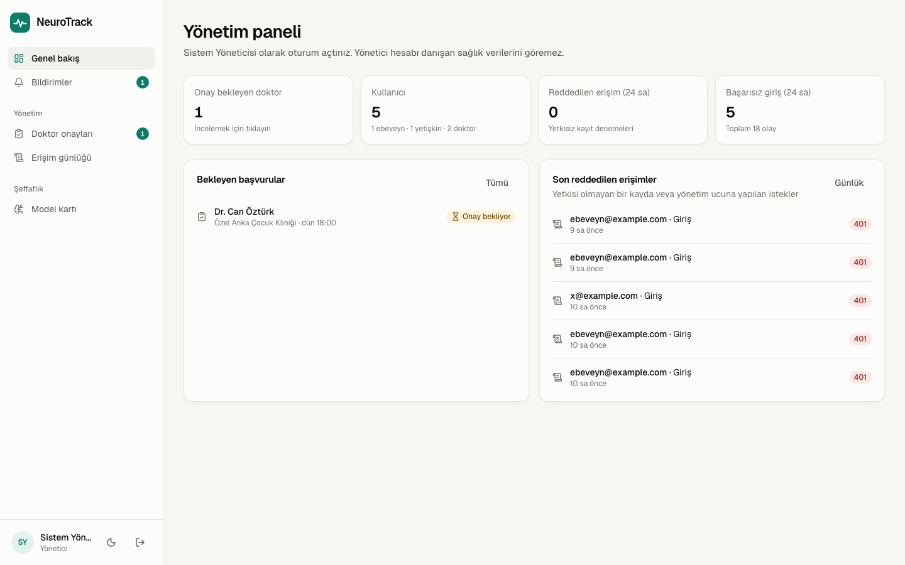
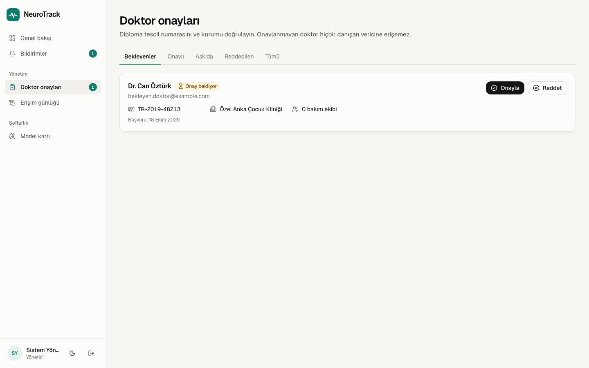
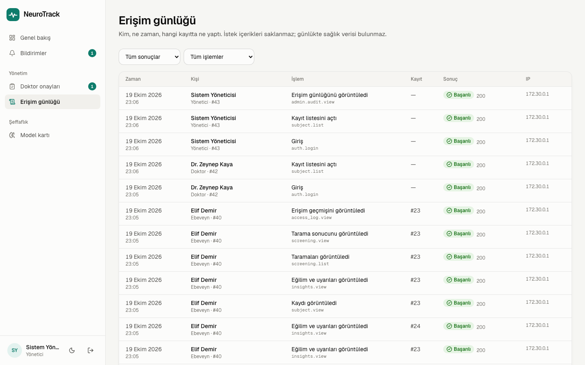
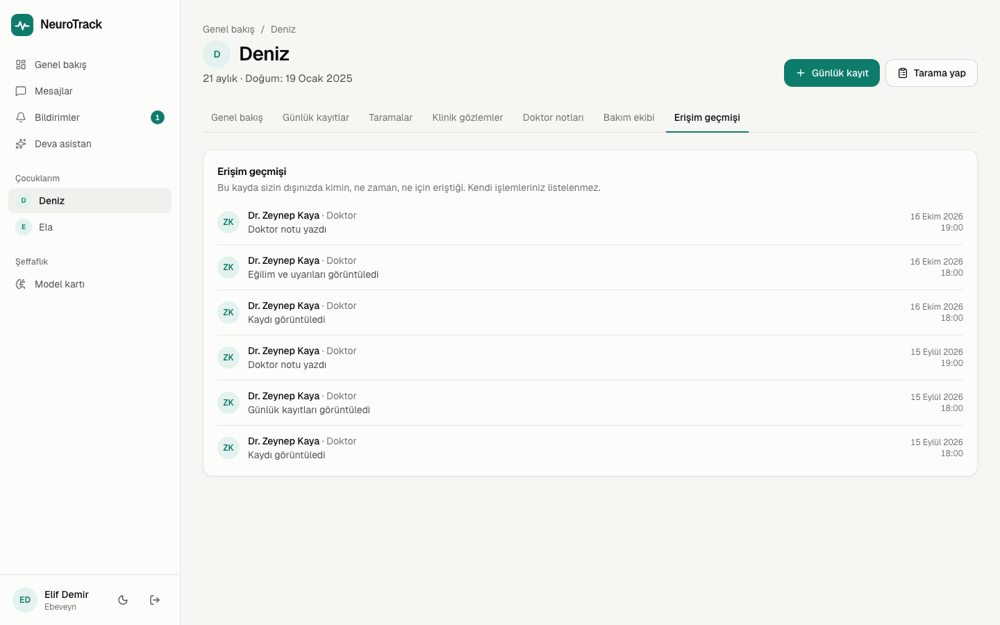
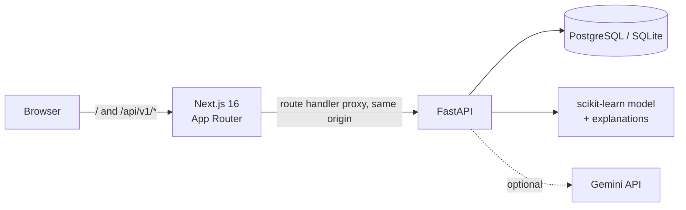

# NeuroTrack AI

[Türkçe](README.md) · **English**

A full-stack platform for **explainable early autism screening**, daily tracking and care-team
communication. Parents, autistic adults and clinicians look at the same data and decide together.

> NeuroTrack is not a diagnostic tool. Screening results only suggest whether a specialist
> assessment is warranted. The user interface is in Turkish.


## What it does

| Role | Capabilities |
|---|---|
| **Parent** | Add children, run a short-form Q-CHAT screening (10 items, 18–24 months), log sleep / social interaction / mood / meltdowns daily, see trends, add a clinician to the care team, message them |
| **Adult** | AQ-10 self-assessment, personal daily tracking with alerts, messaging with the care team |
| **Clinician** | Patient list ranked by alerts and risk, data between visits, clinical observations, notes and next-visit dates. A clinician account sees nothing until an admin verifies their diploma registration number and institution |
| **Admin** | Approve, reject or suspend clinician applications; audit log and security overview. **Cannot see any health data** |
| **Everyone** | "Deva", an assistant that uses tracking data as context; notifications; light/dark theme. Parents and adults see who accessed their record and when, in an "Access history" tab |

| Parent dashboard | Tracking view |
|---|---|
|  |  |
| **Screening result with per-item explanation** | **Clinician dashboard** |
|  |  |
| **Model card** | **Dark theme** |
|  |  |
| **Admin overview** | **Clinician approvals** |
|  |  |
| **Audit log (admin)** | **Access history (record owner)** |
|  |  |

## Machine learning: an honest model, not a bigger one

Details: [MODEL_CARD.md](MODEL_CARD.md) (Turkish) · `/model` page in the app

**Data.** Q-CHAT, Polish cohort: 252 toddlers aged 18–24 months. The label is an autism diagnosis
made in routine care ("community-based diagnosis"); it is not derived from the questionnaire score,
and the dataset does not state which diagnostic instrument was used. The app's 10-item form is the
subset the model selects from the 25 Q-CHAT items; it is not the published Q-CHAT-10.

The widely used UCI autism screening datasets were **deliberately excluded**: their label is a
deterministic function of the item sum (`sum > 6`). Any model trained on them reaches ~100%
accuracy by learning an addition, not autism ([data/README.md](backend/data/README.md)). A 2026
[independent audit](https://www.frontiersin.org/journals/public-health/articles/10.3389/fpubh.2026.1881829/full)
reached the same conclusion for the Kaggle toddler set. Adult screening
therefore uses AQ-10's published scoring rule instead of ML.

**Method.** Nested cross-validation: 5-fold × 5 repeats outside, 5-fold inside. Selecting 10 of
the 25 items (RFE) and the hyperparameter search both happen only on each outer fold's training
split. An earlier version of the project selected items on the full dataset, which inflated the
score (0.944).

| Model (10 items) | AUC | Brier |
|---|---|---|
| Classic total score (25 items, no ML) | 0.847 ± 0.051 | — |
| **Logistic regression (selected)** | **0.934 ± 0.040** | 0.117 |
| SVM (RBF) | 0.935 ± 0.040 | 0.104 |
| Random Forest | 0.932 ± 0.040 | 0.107 |
| XGBoost | 0.930 ± 0.038 | 0.111 |

- The four models differ by noise only, so the one-standard-error rule picks the simplest, fully
  explainable one.
- The threshold targets sensitivity ≥ 0.90 for a screening context: at 0.44, sensitivity is 90%
  and specificity 81%.
- **Every prediction is explained** with exact per-item log-odds contributions that sum to the
  model output (tested).
- Finding: *lining up objects* and *narrow interests* discriminate in the opposite direction at this
  age (higher in controls); documented in the model card.
- **Limitation:** 54% of the sample is autistic, so the score is never shown as a population risk;
  it is only used against the threshold to suggest a referral. There is no external validation yet.

## Security and privacy

- **Access comes from the data owner.** Clinicians cannot add themselves to a patient; the parent or
  adult adds them by email. All authorization rules live in one module:
  [`services/access.py`](backend/app/services/access.py).
- **Clinician verification.** Sign-up requires a diploma registration number and institution, and
  the account starts as "pending". A pending, rejected or suspended clinician cannot be added to a
  care team and cannot read any record. Suspension cuts access immediately; the care-team link is
  kept, so re-approval restores it.
- **Admins cannot see health data.** The admin role cannot be chosen at sign-up; it is created
  from the command line only. Admins manage accounts and the audit log; patient endpoints return
  404 for them too.
- **Audit log.** Every read and write of patient data, logins and admin actions are recorded,
  including denied attempts. Logging is done in one middleware
  ([`services/audit.py`](backend/app/services/audit.py)); a new endpoint is logged by adding one row
  to a table. Request bodies are never stored, so the log contains no health data. Record owners
  see their own history (without IPs or internal ids); admins can filter the full log.
- A record owned by someone else returns **404** rather than 403, so ids cannot be probed. Tests:
  [`test_access_control.py`](backend/tests/test_access_control.py).
- The JWT travels in an **httpOnly, SameSite=Lax** cookie. The API is served from the same origin
  through Next.js, so JavaScript never sees the token.
- bcrypt password hashing with constant-cost verification against account enumeration by timing.
  Login rate limiting counts failures only and has two layers: per account (IP-independent, so a
  spoofed `X-Forwarded-For` cannot bypass it) and per IP (against one source spraying many accounts).
- The client IP reaches the backend in `X-Forwarded-For` from the Next.js proxy, and the backend
  trusts that header only from the frontend container. Because clients can send the header
  themselves, production needs a reverse proxy that rewrites it; logged IPs are hints, not evidence.
- **LLM privacy:** no names or identifiers are sent to the assistant, only summary statistics of
  the last 14 days. Crisis phrases are detected independently of the model call, and emergency
  help information is always added to the reply.

## Architecture



| Layer | Technology |
|---|---|
| Frontend | Next.js 16, React 19, TypeScript, Tailwind CSS 4, TanStack Query, Recharts |
| Backend | FastAPI, SQLAlchemy 2, Alembic, Pydantic 2, PyJWT, bcrypt |
| ML | scikit-learn, XGBoost (comparison only), pandas |
| LLM | Google Gemini (`google-genai`); rule-based replies when no key is set |
| Infrastructure | Docker Compose, PostgreSQL 17, GitHub Actions (SQLite + PostgreSQL test matrix, Docker smoke test) |

## Running it

### With Docker (recommended)

```bash
echo "JWT_SECRET=$(openssl rand -base64 48)" > .env
docker compose up --build
```

- App: http://localhost:3000
- API docs: http://localhost:8000/api/v1/docs

Demo accounts are created automatically (password `demo1234`). The emails are Turkish role names:
`ebeveyn@example.com` (parent), `yetiskin@example.com` (adult), `doktor@example.com` (clinician),
`yonetici@example.com` (admin) and `bekleyen.doktor@example.com` (clinician awaiting approval).
The login screen also has one-click demo buttons. To use Gemini for the assistant, add
`GEMINI_API_KEY=...` to `.env`.

In a real deployment, turn off demo data (`SEED_DEMO=false`) and create the first admin from the
command line:

```bash
docker compose exec backend python -m app.cli create-admin --email admin@example.org --name "Full Name"
```

### Local development

```bash
# Backend (Python 3.11+)
cd backend
python -m venv .venv && source .venv/bin/activate
pip install -r requirements-dev.txt
alembic upgrade head
python -m app.seed
uvicorn app.main:app --reload --port 8000

# Frontend (Node 20.9+), in another terminal
cd frontend
npm install
npm run dev        # http://localhost:3000
```

### Tests and checks

```bash
cd backend && pytest && ruff check app tests     # 56 tests
cd frontend && npx eslint src && npx tsc --noEmit && npm run build
```

### Retraining the model

```bash
cd backend
python -m app.ml.train_toddler    # ~1 minute; regenerates the model and metadata in artifacts/
                                  # (the XGBoost comparison needs requirements-dev.txt)
```

## Project structure

```
backend/
  app/
    core/        settings, database, JWT/bcrypt, auth dependencies
    routers/     auth, subjects, records, screenings, messages, notifications, assistant, admin
    services/    access (authorization), audit (audit log), insights (alerts), assistant (LLM), ratelimit, notify
    ml/          train_toddler (nested CV), toddler (prediction + explanation), aq10, artifacts/
    models.py    SQLAlchemy models (a single "Subject" model for adults and children)
    seed.py      demo data
    cli.py       admin account creation
  migrations/    Alembic
  tests/         pytest (authorization, clinician approval, audit log, auth, screening, messaging)
  data/          datasets and data notes
frontend/
  src/app/       pages: (auth), (app) dashboard, model card, landing page
  src/components ui, charts, forms, app shell
  src/lib/       API client, queries, types, formatting
  src/app/api/v1 backend proxy (same origin, forwards X-Forwarded-For)
  src/proxy.ts   session redirects
MODEL_CARD.md
docker-compose.yml
```

## License

The code is licensed under [MIT](LICENSE). The datasets in `backend/data/` are redistributed under
their own licenses (CC BY 4.0): the Polish Q-CHAT data belongs to Niedźwiecka, Pisula and
Domasiewicz (Mendeley Data, 2020), the UCI autism screening data to Thabtah (2017). Details:
[backend/data/README.md](backend/data/README.md).

## Roadmap

- External validation of the Q-CHAT model on another cohort
- Replacing the Turkish item wording with a validated adaptation
- Redis-based rate limiting for multi-instance deployments
- Playwright end-to-end tests in CI
