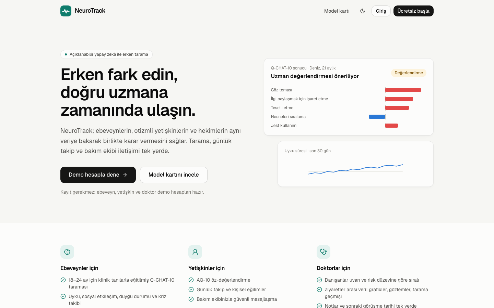
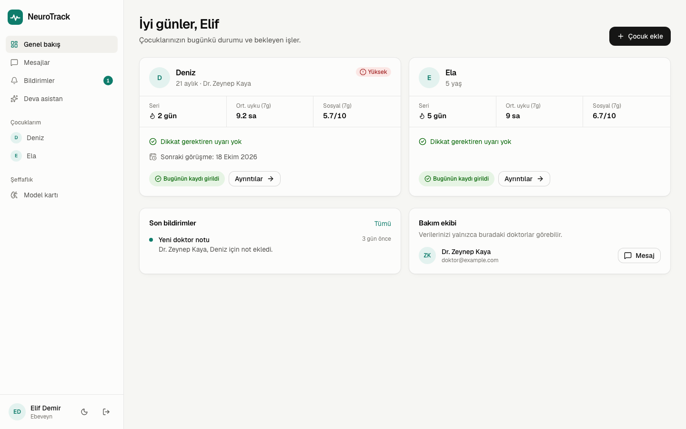
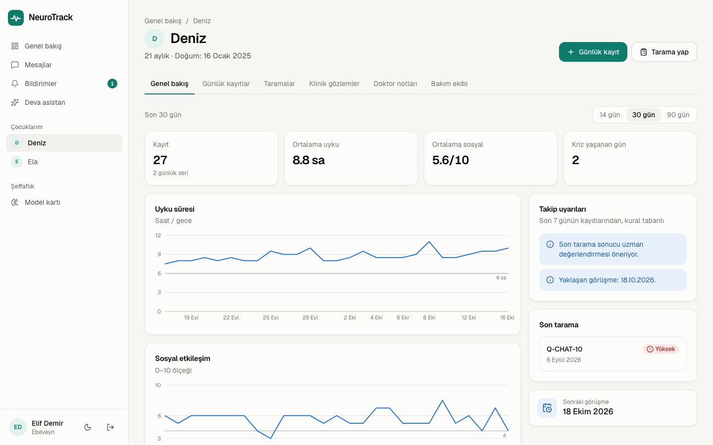
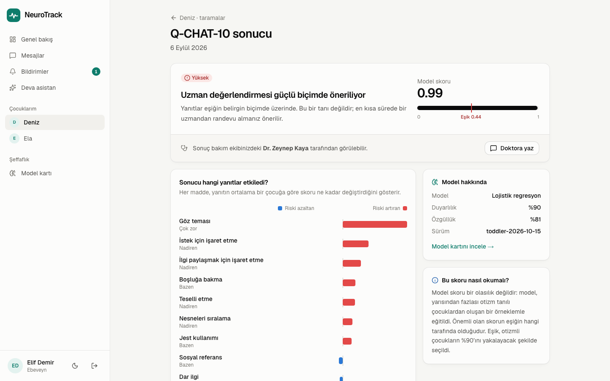
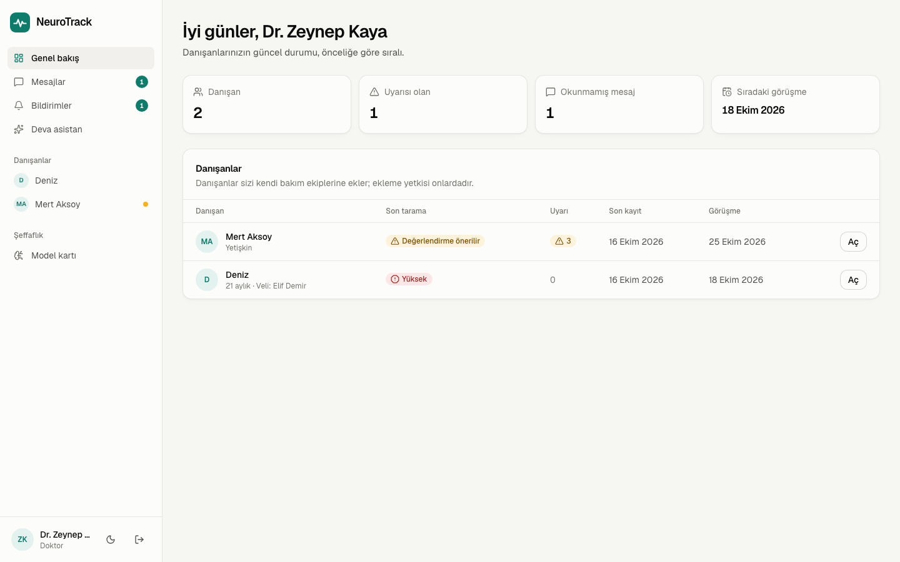
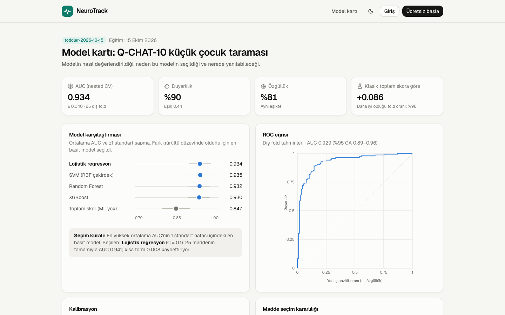
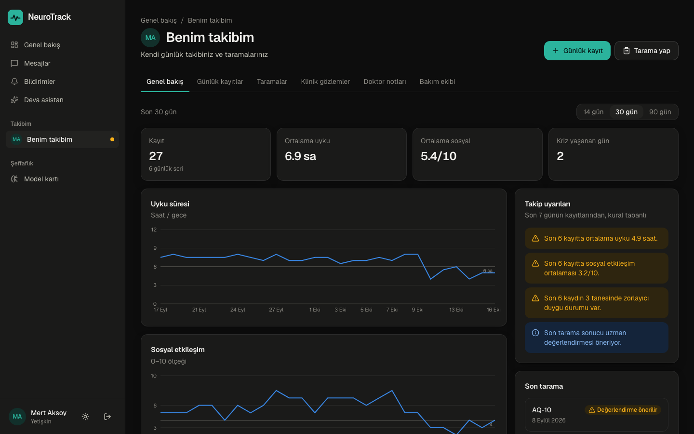
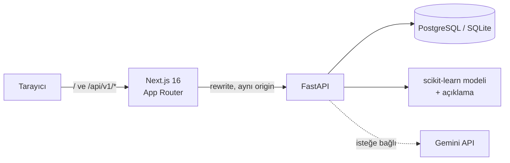

# NeuroTrack AI

Otizm spektrumu için **açıklanabilir erken tarama**, günlük takip ve bakım ekibi iletişimi sunan
full-stack bir platform. Ebeveynler, otizmli yetişkinler ve hekimler aynı veriye bakarak birlikte
karar verir.

> NeuroTrack bir tanı aracı değildir. Tarama sonuçları yalnızca uzman değerlendirmesine
> yönlendirme amacı taşır.



## Neler var?

| Rol | Yapabildikleri |
|---|---|
| **Ebeveyn** | Çocuk ekleme, 18–24 ay için Q-CHAT-10 taraması, günlük uyku/sosyal etkileşim/duygu/kriz kaydı, eğilim grafikleri, doktoru bakım ekibine ekleme, mesajlaşma |
| **Yetişkin** | AQ-10 öz-değerlendirme, kişisel günlük takip ve uyarılar, bakım ekibiyle mesajlaşma |
| **Doktor** | Uyarı ve risk düzeyine göre sıralı danışan listesi, ziyaretler arası veri, klinik gözlem, not ve sonraki görüşme tarihi |
| **Herkes** | Takip verisini bağlam olarak kullanan "Deva" asistanı, bildirimler, açık/koyu tema |

| Ebeveyn paneli | Takip ekranı |
|---|---|
|  |  |
| **Tarama sonucu ve açıklaması** | **Doktor paneli** |
|  |  |
| **Model kartı** | **Koyu tema** |
|  |  |

## Makine öğrenmesi: daha büyük değil, daha dürüst model

Ayrıntılar: [MODEL_CARD.md](MODEL_CARD.md) · uygulamada `/model` sayfası

**Veri.** Q-CHAT, Polonya kohortu: 18–24 aylık 252 çocuk. Etiketler ADOS-2, ADI-R ve DSM-5 ile
konmuş klinik tanılar. Yaygın kullanılan UCI otizm veri setleri ise bilinçli olarak dışarıda
bırakıldı: bu setlerde etiket, soruların toplamından türetilmiş (`toplam > 6`). Bu yüzden her model
%100'e yakın doğruluk gösterir, ama öğrendiği şey bir toplama işleminden ibarettir
([data/README.md](backend/data/README.md)). Yetişkin taraması bu nedenle AQ-10'un yayımlanmış
puanlama kuralıyla yapılıyor.

**Yöntem.** Nested cross-validation kullanıldı: dışta 5 kat × 5 tekrar, içte 5 kat. 25 maddeden
10'unun seçimi (RFE) ve hiperparametre araması her dış fold'un yalnızca eğitim kısmında yapıldı.
Projenin önceki sürümü maddeleri tüm veri üzerinde seçtiği için başarıyı olduğundan yüksek
gösteriyordu (0.944).

| Model (10 madde) | AUC | Brier |
|---|---|---|
| Klasik toplam skor (25 madde, ML yok) | 0.847 ± 0.051 | — |
| **Lojistik regresyon (seçilen)** | **0.934 ± 0.040** | 0.117 |
| SVM (RBF) | 0.935 ± 0.040 | 0.104 |
| Random Forest | 0.932 ± 0.040 | 0.107 |
| XGBoost | 0.930 ± 0.038 | 0.111 |

- Dört modelin farkı gürültü düzeyinde. Bu yüzden "tek standart hata" kuralıyla en basit ve tam
  açıklanabilir model seçildi.
- Eşik, tarama bağlamına göre duyarlılık ≥ 0.90 olacak şekilde seçildi: 0.44 eşiğinde duyarlılık
  %90, özgüllük %81.
- **Her tahmin açıklanır.** Her maddenin log-odds katkısı hesaplanıyor; katkıların toplamı modelin
  çıktısını birebir veriyor (test edildi).
- Bulgu: *nesneleri sıraya dizme* ve *dar ilgi* maddeleri bu yaşta ters yönde ayırt ediyor
  (kontrol grubunda daha yüksek). Bu durum model kartında belgelendi.
- **Sınırlılık:** Örneklemin %54'ü otizm tanılı. Bu yüzden skor popülasyon riski olarak
  sunulmuyor; yalnızca eşiğe göre yönlendirme yapılıyor.

## Güvenlik ve gizlilik

- **Erişim veri sahibinden gelir.** Doktorlar kendilerini bir danışana ekleyemez; danışan veya
  ebeveyn doktoru e-posta adresiyle bakım ekibine ekler. Tüm yetki kuralları tek bir modülde:
  [`services/access.py`](backend/app/services/access.py).
- Başka bir kullanıcıya ait kayıt 403 yerine **404** döner; ID tahminiyle kaydın var olduğu
  anlaşılamaz. Bunu kanıtlayan testler: [`test_access_control.py`](backend/tests/test_access_control.py).
- JWT, **httpOnly + SameSite=Lax** cookie içinde taşınır. API, Next.js üzerinden aynı origin'den
  sunulduğu için JavaScript token'a erişemez.
- bcrypt ile şifre saklama, yalnızca başarısız denemeleri sayan giriş hız sınırı, yanıt
  süresinden hesap varlığının anlaşılmasına karşı sabit maliyetli doğrulama.
- **LLM gizliliği:** Asistana isim veya kimlik bilgisi gönderilmez; yalnızca son 14 günün özet
  istatistikleri bağlam olarak eklenir. Kriz ifadeleri model çağrısından bağımsız yakalanır ve
  yanıta her durumda acil yardım bilgisi eklenir.

## Mimari



| Katman | Teknoloji |
|---|---|
| Frontend | Next.js 16, React 19, TypeScript, Tailwind CSS 4, TanStack Query, Recharts |
| Backend | FastAPI, SQLAlchemy 2, Alembic, Pydantic 2, PyJWT, bcrypt |
| ML | scikit-learn, XGBoost (karşılaştırma), pandas |
| LLM | Google Gemini (`google-genai`); anahtar yoksa kural tabanlı yanıt |
| Altyapı | Docker Compose, PostgreSQL 17, GitHub Actions (SQLite + PostgreSQL test matrisi) |

## Çalıştırma

### Docker ile (önerilen)

```bash
echo "JWT_SECRET=$(openssl rand -base64 48)" > .env
docker compose up --build
```

- Uygulama: http://localhost:3000
- API dokümantasyonu: http://localhost:8000/api/v1/docs

Demo hesaplar otomatik oluşturulur (şifre: `demo1234`): `ebeveyn@example.com`,
`yetiskin@example.com`, `doktor@example.com`. Giriş ekranındaki demo butonlarıyla tek tıkla da
girilebilir. Asistanın Gemini kullanması için `.env` dosyasına `GEMINI_API_KEY=...` ekleyin.

### Yerel geliştirme

```bash
# Backend (Python 3.11+)
cd backend
python -m venv .venv && source .venv/bin/activate
pip install -r requirements-dev.txt
alembic upgrade head
python -m app.seed
uvicorn app.main:app --reload --port 8000

# Frontend (Node 20.9+), ayrı bir terminalde
cd frontend
npm install
npm run dev        # http://localhost:3000
```

### Testler ve kontroller

```bash
cd backend && pytest && ruff check app tests     # 39 test
cd frontend && npx eslint src && npx tsc --noEmit && npm run build
```

### Modeli yeniden eğitmek

```bash
cd backend
python -m app.ml.train_toddler    # yaklaşık 1 dakika; artifacts/ altındaki model ve meta dosyasını yeniler
```

## Proje yapısı

```
backend/
  app/
    core/        ayarlar, veritabanı, JWT/bcrypt, kimlik doğrulama bağımlılıkları
    routers/     auth, subjects, records, screenings, messages, notifications, assistant
    services/    access (yetki), insights (uyarılar), assistant (LLM), ratelimit, notify
    ml/          train_toddler (nested CV), toddler (tahmin + açıklama), aq10, artifacts/
    models.py    SQLAlchemy modelleri (tek "Subject" modeli: yetişkin ve çocuk)
    seed.py      demo verisi
  migrations/    Alembic
  tests/         pytest (yetki, kimlik doğrulama, tarama, uyarılar, mesajlaşma)
  data/          veri setleri ve veri notları
frontend/
  src/app/       sayfalar: (auth), (app) panel, model kartı, tanıtım sayfası
  src/components ui, grafikler, formlar, uygulama kabuğu
  src/lib/       API istemcisi, sorgular, tipler, biçimlendirme
  src/proxy.ts   oturum yönlendirmesi
MODEL_CARD.md
docker-compose.yml
```

## Bilinen sorunlar

- Herkese açık `/model` sayfasında, boş önbellekli ilk ziyarette aralıklı olarak (testlerde
  yaklaşık her 4 yüklemeden 1'inde) React hydration uyarısı (#418) görülüyor. React yalnızca
  Next.js'in gizli metadata bölümünü istemcide yeniden çiziyor; görünen içerik değişmiyor. Sorun
  Next.js 16.4'ün akışlı metadata davranışına kadar daraltıldı ama kesin kaynağı henüz bulunamadı.

## Yol haritası

- Q-CHAT modelinin başka bir kohortta dış doğrulaması
- Türkçe soru metinlerinin doğrulanmış uyarlamayla değiştirilmesi
- Çoklu instance dağıtımı için Redis tabanlı hız sınırlama
- Playwright uçtan uca testlerinin CI'a eklenmesi
